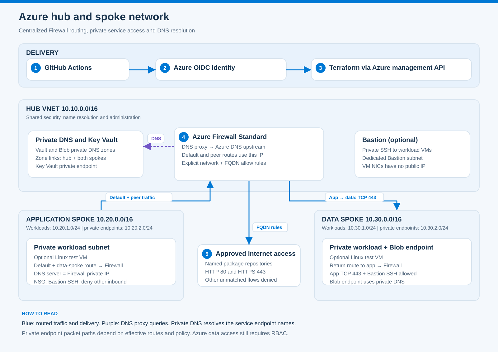
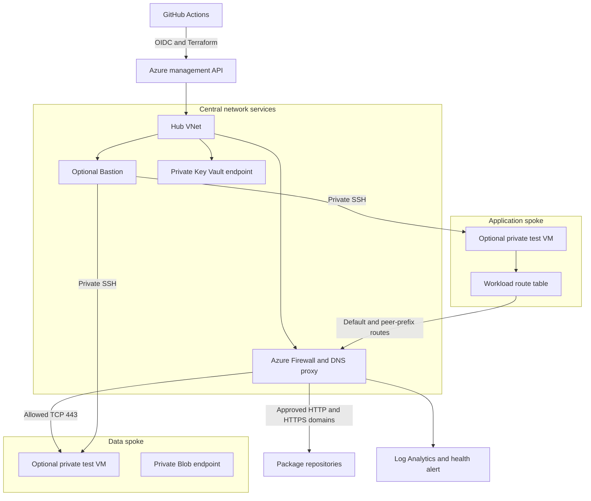

# Azure Hub and Spoke Network Platform

[](https://github.com/dotman01k/azure-hub-spoke-platform/actions/workflows/validate.yml)

A Terraform implementation of centralized Azure network security, private service connectivity and controlled application-to-data traffic. The platform provisions a hub, two spokes, Azure Firewall Standard with DNS proxy, private endpoints, private DNS zones, route tables and workload NSGs. Optional Bastion and private test VMs support hands on network validation.

**Validation:** Terraform provider schema validation, topology tests and shell checks passed in [GitHub Actions](https://github.com/dotman01k/azure-hub-spoke-platform/actions/runs/39376127255).

**Cost:** Azure Firewall Standard is always provisioned when you apply this project, including dev. It incurs ongoing charges even without application traffic. Bastion and test VMs add charges when enabled. Review Azure Pricing Calculator before any apply.

## Contents

1. [What the project implements](#what-the-project-implements)
2. [Architecture and traffic paths](#architecture-and-traffic-paths)
3. [Configuration and environments](#configuration-and-environments)
4. [Repository structure](#repository-structure)
5. [Deployment](#deployment)
6. [Authentication and permissions](#authentication-and-permissions)
7. [Validation](#validation)
8. [Operations and troubleshooting](#operations-and-troubleshooting)
9. [Cleanup and limitations](#cleanup-and-limitations)

## What the project implements

| Area | Implementation |
| --- | --- |
| Infrastructure | Terraform 1.13.0, AzureRM 4.52.0, signed provider lock and reusable spoke module |
| Network topology | One hub and two spokes with bidirectional hub peerings and forwarded traffic enabled |
| Centralized egress | Workload default routes point to Azure Firewall; explicit package repository FQDN rules |
| Interspoke traffic | Explicit peer-prefix routes through Firewall; app-to-data TCP 443 allowed, other unmatched traffic denied |
| DNS | Firewall DNS proxy, Azure DNS upstream and centralized private zones linked to hub and spokes |
| Private services | Private Key Vault and Blob storage endpoint; public access disabled on both |
| Workload isolation | Dedicated workload/private endpoint subnets and workload NSGs with explicit inbound exceptions |
| Administration | Optional Basic Bastion; optional Linux test VMs with SSH keys, no NIC public IPs and managed identities |
| Monitoring | Firewall diagnostics, Log Analytics, firewall health metric alert and email action group |
| Delivery | GitHub OIDC, environment-based plan/apply separation and saved plan artifact |
| Validation | Terraform schema checks, address topology tests, example configuration checks and shell syntax |

## Architecture and traffic paths



1. **Delivery:** GitHub Actions exchanges its OIDC identity for Azure access, and Terraform configures the network through the management API.
2. **Routing:** Application and data workload subnets send default and remote spoke traffic to the Firewall private IP, with return routes in the opposite spoke.
3. **Filtering:** Firewall allows application-to-data TCP 443 and named package domains on HTTP/HTTPS. NSGs add workload subnet boundaries.
4. **DNS:** Spoke clients use the Firewall DNS proxy. The upstream resolver can resolve private service records through the hub's linked private DNS zones.
5. **Private access:** Key Vault has a private endpoint in the hub, and Blob storage has one in the data spoke. Effective routes and data RBAC determine usable service access; the diagram does not imply every private endpoint packet traverses Firewall.

[Open the full diagram](docs/architecture.svg) · [Design explanation](docs/architecture.md)



The diagram shows intended traffic responsibilities. Private endpoint traffic has more specific platform routes and is **not claimed to be fully inspected by Firewall** in this implementation. Private DNS alone does not alter the packet path. See [architecture decisions](docs/architecture.md) before extending endpoint inspection.

### Address plan

`config/topology.json` is the shared address and allowlist source consumed by Terraform and the tests.

| Network or subnet | CIDR |
| --- | --- |
| Hub VNet | `10.10.0.0/16` |
| AzureFirewallSubnet | `10.10.0.0/26` |
| Optional AzureBastionSubnet | `10.10.1.0/26` |
| Hub private endpoints | `10.10.2.0/24` |
| Application spoke | `10.20.0.0/16` |
| Application workloads | `10.20.1.0/24` |
| Application private endpoints | `10.20.2.0/24` |
| Data spoke | `10.30.0.0/16` |
| Data workloads | `10.30.1.0/24` |
| Data private endpoints | `10.30.2.0/24` |

There is no direct app-to-data peering. Each workload subnet has a default route and an explicit route for the other spoke through the Firewall private IP. Return routes are configured in the other spoke as well. Hub-bound traffic can follow direct peering routes, and private endpoint routes require separate inspection design.

### Allowed traffic

| Path | Control |
| --- | --- |
| App workload subnet to data workload subnet TCP 443 | Explicit Firewall network rule plus data NSG allow rule |
| Other new interspoke flows | Unmatched Firewall traffic denied; workload NSG denies unmatched inbound |
| Spoke workload to approved package domains | Firewall application rules on HTTP 80 and HTTPS 443 |
| Spoke DNS | VNet DNS server is the Firewall private IP; DNS proxy uses Azure DNS upstream |
| Bastion subnet to test VM SSH | Workload NSG allows TCP 22 from the dedicated Bastion subnet |
| Blob and Key Vault access | Private endpoints plus Azure data-plane RBAC |

The optional data VM does not run a web server by default. An allowed TCP 443 network path does not imply a listening application. A successful positive service test requires a deliberately configured listener.

## Configuration and environments

| Setting | Dev example | Prod example |
| --- | --- | --- |
| Firewall | Standard, no explicit zones | Standard, zones 1, 2 and 3 |
| Bastion | Disabled | Enabled, Basic SKU |
| Test VMs | Disabled | Disabled |
| Blob storage replication | LRS | ZRS |
| Logs | 30 days, 1 GB daily ingestion cap | 30 days, 5 GB daily ingestion cap |
| Default location | eastus | eastus |

The zone setting applies to Firewall and its public IP. It does not assert zone redundancy for every optional component. Confirm regional support before applying.

Dev and prod use different RGs and backend keys but share the example address plan. Change the ranges before connecting these environments together or to an overlapping existing network.

## Repository structure

| Path | Purpose |
| --- | --- |
| [config/topology.json](config/topology.json) | VNet/subnet addressing, explicit domains and interspoke rule |
| [infra/main.tf](infra/main.tf) | Hub and reusable spoke module instantiation |
| [infra/firewall.tf](infra/firewall.tf) | Firewall, policy, DNS proxy and permitted traffic |
| [infra/modules/spoke](infra/modules/spoke) | Spoke VNets, peerings, routing and workload NSGs |
| [infra/private-services.tf](infra/private-services.tf) | Key Vault, storage, private endpoints and DNS integration |
| [infra/access.tf](infra/access.tf) | Optional Bastion, test VMs and workload data RBAC |
| [infra/monitoring.tf](infra/monitoring.tf) | Diagnostics, workspace and health alert |
| [infra/environments](infra/environments) | Complete JSON tfvars examples |
| [scripts](scripts) | Bootstrap, state initialization and read-only inspection |
| [tests](tests) | Address containment, overlap and allowlist validation |
| [.github/workflows](.github/workflows) | Validation and manual infrastructure deployment |
| [docs/setup.md](docs/setup.md) | Permissions, variables, bootstrap and deployment steps |
| [docs/operations.md](docs/operations.md) | DNS, routing, logs, troubleshooting and cleanup |

## Deployment

### 1. Inspect and validate

```bash
git clone https://github.com/dotman01k/azure-hub-spoke-platform.git
cd azure-hub-spoke-platform
python -m unittest discover -s tests -v
terraform -chdir=infra fmt -check -recursive
terraform -chdir=infra init -backend=false -lockfile=readonly
terraform -chdir=infra validate
```

Review the topology, Firewall cost, subscription quota and environment examples before Azure authentication. No Azure credentials are needed for these validation commands.

### 2. Bootstrap state and federation

From an Azure user account authorized to register providers, create identities and assign roles:

```bash
az login
export SUBSCRIPTION_ID='<your-subscription-id>'
export DEPLOY_ENV=dev
export STATE_ACCOUNT='<globally-unique-state-account>'
export GITHUB_REPOSITORY=dotman01k/azure-hub-spoke-platform
export LOCATION=eastus
bash scripts/bootstrap.sh
```

The script creates a platform RG, separate state RG, Entra-authenticated state storage and one CI managed identity per environment. It enables state blob versioning and seven-day blob soft delete. First use may need to wait for Azure RBAC propagation; inspect any failure before retrying.

### 3. Configure GitHub environments

Create `dev-plan` and `dev`, then `prod-plan` and `prod` as needed. Restrict deployment branches to `main`; configure required reviewers for apply environments where your GitHub plan supports them.

| Variable | Value |
| --- | --- |
| `AZURE_SUBSCRIPTION_ID` | Target subscription ID |
| `AZURE_TENANT_ID` | Entra tenant ID |
| `INFRA_CLIENT_ID` | CI managed identity client ID from bootstrap |
| `STATE_RESOURCE_GROUP` | `rg-hubspoke-state` |
| `STATE_STORAGE_ACCOUNT` | Bootstrap state account |
| `TFVARS_JSON` | JSON from the selected environment example with real values |

Set these variables in both the plan and matching apply environments. Use the same CI identity, backend and configuration in each pair. Do not put credentials or private SSH keys in `TFVARS_JSON`.

### 4. Plan and apply

Run **Network Infrastructure** with `operation=plan`. Review the proposed changes and the saved `plan.txt` artifact.

When ready, run `operation=apply`. That invocation generates a new plan and then waits for any configured apply-environment approval. Review **that invocation's plan** before approving. The apply job consumes its saved binary plan. Defining an environment in YAML does not enable approvals unless reviewers are configured.

### 5. Optional end-to-end checks

Enable `test_vms_enabled` and supply an OpenSSH public key only when you want two additional private VMs. Enable Bastion if browser SSH is needed. There are no public NIC IPs and password login is disabled.

The baseline optional VMs are test endpoints, not a deployed business application. They have managed identities with Key Vault Secrets User and Storage Blob Data Reader permissions. The project creates no actual vault secrets, Blob containers or data objects.

Use the [runbook](docs/operations.md) to inspect DNS, effective routes, allow/deny traffic, private access and Firewall logs after deployment.

## Authentication and permissions

GitHub jobs authenticate with OIDC federation; no Azure client secret is stored in the repository. For dev, trusted subjects are:

```text
repo:dotman01k/azure-hub-spoke-platform:environment:dev-plan
repo:dotman01k/azure-hub-spoke-platform:environment:dev
```

Prod uses its corresponding environment names. CI has Contributor and User Access Administrator only on the platform RG and Blob Data Contributor on the state account. RBAC delegation supports the optional VM data roles and Key Vault permission model; protect this identity and its environments accordingly.

The workflow uses Azure management APIs and runs on a GitHub-hosted runner. It does not attempt private data-plane reads or write application secrets. Backend state networking remains public with Entra authentication so these jobs can reach it. See [setup](docs/setup.md) before restricting backend networking.

Terraform state can contain sensitive provider-computed data, including storage key material, even when shared-key access is disabled. Protect state and plan artifacts; do not publish them as repository files.

## Validation

| Check | Purpose |
| --- | --- |
| Terraform fmt and validate | Syntax, provider schema and resource reference checks |
| Actual topology validation | Rejects overlapping VNets/subnets and subnets outside their parent |
| Negative topology tests | Ensures malformed overlap and wildcard inputs fail validation |
| Environment checks | Confirms dev/prod examples are distinct and optional VMs start disabled |
| Shell syntax | Validates helper scripts parse |
| GitHub Actions syntax | Checked during authoring with actionlint |

The tests do not prove Azure quota availability, live DNS resolution, packet routing, private endpoint provisioning or service health. Those require an authorized deployment and live checks. Terraform reads `config/topology.json`; keep the topology tests as a required check before deployment.

## Operations and troubleshooting

```bash
export AZURE_RESOURCE_GROUP=rg-hubspoke-dev
export NETWORK_PREFIX=dotunnet-dev
bash scripts/inspect-network.sh
```

This helper reads provisioned Firewall state, peerings, route tables and endpoints. It does not modify resources. The [runbook](docs/operations.md) includes DNS checks and Log Analytics queries.

| Symptom | Check first |
| --- | --- |
| State 403 | Entra auth, Blob Data Contributor scope and role propagation |
| OIDC login failure | Exact repository/environment subject and CI client ID |
| Spoke names resolve publicly | Firewall DNS proxy, upstream and hub DNS zone links |
| Interspoke timeout | Routes in both directions, forwarded peerings, Firewall rule, destination NSG and listener |
| Private service 403 | Managed identity and data role; private IP resolution alone does not authorize access |
| Internet timeout | Requested hostname/protocol matches the explicit application allowlist |
| SSH unavailable | Bastion enabled, private VM exists, correct SSH key and subnet NSG rule |

## Cleanup and limitations

There is no automatic destroy workflow. Review the selected subscription, state key and `terraform plan -destroy` before deliberately removing a disposable environment. Firewall, Bastion, test VM disks and log ingestion can continue billing while the project is idle.

Terraform destroy retains bootstrap identities, resource groups and state storage. Remove those separately only after checking dependencies and retaining required state history. Key Vault purge protection prevents immediate purge and name reuse during retention.

This project does not implement VPN/ExpressRoute, DNS Private Resolver for hybrid forwarding, full private endpoint traffic inspection, TLS decryption, Firewall Premium IDPS, a production application, application backup or automatic incident remediation. Firewall threat intelligence runs in Alert mode. Basic Bastion is not claimed to be zone redundant. VNet flow logging is not configured; Firewall diagnostics provide the included traffic visibility.

## References

1. [Azure Firewall DNS settings](https://learn.microsoft.com/azure/firewall/dns-settings)
2. [Private Endpoint DNS integration](https://learn.microsoft.com/azure/private-link/private-endpoint-dns-integration)
3. [Private Link in a hub and spoke network](https://learn.microsoft.com/azure/architecture/networking/guide/private-link-hub-spoke-network)
4. [AzureRM Firewall Policy resource](https://registry.terraform.io/providers/hashicorp/azurerm/4.52.0/docs/resources/firewall_policy)
5. [Setup](docs/setup.md), [architecture](docs/architecture.md), [operations](docs/operations.md) and [validation evidence](docs/validation.md)
